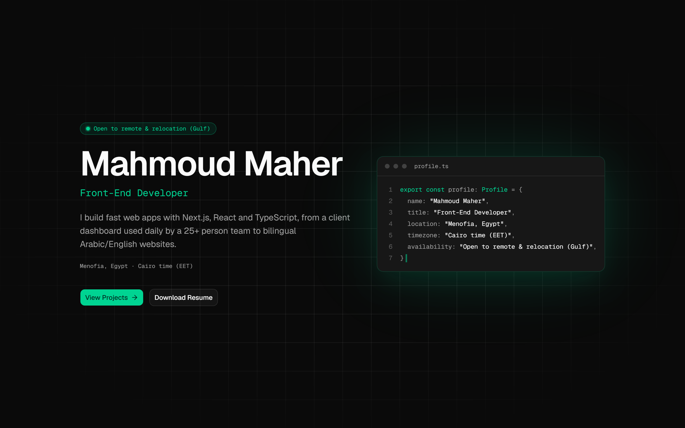

# Mahmoud Maher - Front-End Developer

I build dashboards and bilingual web apps with Next.js, React and TypeScript. My work includes an analytics platform for a UAE sports club and a tracker a 25+ person team uses every day.

**[Live site](https://mahmoudmaher.site)** · **[Resume (PDF)](https://mahmoudmaher.site/Mahmoud-Maher-Resume.pdf)** · **[LinkedIn](https://www.linkedin.com/in/mahmoudmaherofficial2/)** · **[Email](mailto:mahmoudmaherofficial@gmail.com)**

Menofia, Egypt · Cairo time (EET) · Open to remote & relocation (Gulf)



## About

Hi, I'm Mahmoud. I'm a front-end developer in Egypt, and I build the tools teams run their work on: admin dashboards, management systems, company websites and e-commerce stores.

I started in July 2024 with an internship at NTG Clarity, building role-based dashboards for a hospital management system. Since then I've shipped 10+ projects for clients as a freelancer, often replacing paper and Excel with tools people open every day. I owned most of them end to end, so I'm comfortable with the backend and deployment too (NestJS, Express, MongoDB, MySQL, Docker).

I care about typed, readable code, interfaces that feel fast, and shipping when I said I would.

## Selected work

### Sports Performance Analytics Platform

_Client Project · Sole Developer (full-stack)_

Analytics platform for a UAE-based sports club, tracking 100+ athletes across multiple sports. Built the full platform alone: athlete profiles, data entry, KPI dashboards with Recharts, PDF/Excel export, and role-based access so each role sees only its data.

`Next.js` `TypeScript` `Tailwind CSS` `shadcn/ui` `NestJS` `Prisma` `MySQL` `Recharts`

### Activity Watcher

_Client Project · Full-Stack Developer_

Activity tracker used daily by a 25+ person team. Built secure auth with JWT access/refresh tokens in HTTP-only cookies and role-based access (Admin/Member), dashboards with charts, and search, filters and pagination. Deployed with Docker on the client's server.

`Next.js` `TypeScript` `TanStack Query` `React Hook Form` `Zod` `Recharts` `Node.js` `Express.js` `MongoDB` `Docker`

### Bilingual Website for Alarab Construction

_Client Project · Front-End Developer_

Bilingual company website presenting the company's services and projects. Built a fully bilingual Arabic/English site with RTL support, SEO setup, and handled deployment and launch.

`Next.js` `Tailwind CSS` `i18n / RTL` `SEO`

### LuxeLane

_Personal Project · Full-Stack Developer · [GitHub](https://github.com/mahmoudmaherofficial/luxelane-frontend)_

Full-stack e-commerce store with a searchable product catalog and user accounts. Built the Next.js front end and a REST API with Express.js and MongoDB, including authentication, role-based authorization, and search, filter, sort and pagination.

`Next.js` `Tailwind CSS` `Node.js` `Express.js` `MongoDB` `Vercel`

## Experience

**Freelance Front-End Developer** · Oct 2024 – Present
Built and shipped 10+ client projects end to end: dashboards, management systems, company websites and e-commerce stores.

**Front-End Intern, NTG Clarity** · Jul 2024 – Sep 2024
Built role-based dashboards (admin/doctor/patient), appointment booking, and protected routes for a hospital management system in a team of 4, using React and a REST API.

## Skills

- **Front-End:** React, Next.js (App Router, SSR/SSG), TypeScript, JavaScript, HTML5, CSS3, Tailwind CSS, shadcn/ui, TanStack Query, React Hook Form, Zod, Recharts
- **Backend:** Node.js, Express.js, NestJS, MongoDB, MySQL, Prisma, REST APIs, JWT auth
- **Tooling:** Git, GitHub Actions, Docker, Vercel
- **Motion:** Framer Motion (used in this repo)

## Contact

I'm looking for a full-time front-end role: remote, on-site in Egypt, or with relocation to the Gulf. I'm also open to freelance and contract work. Email is the fastest way to reach me, and I reply within 24 hours.

- Email: [mahmoudmaherofficial@gmail.com](mailto:mahmoudmaherofficial@gmail.com)
- [WhatsApp](https://wa.me/mahmoudmaher_official)
- [LinkedIn](https://www.linkedin.com/in/mahmoudmaherofficial2/)
- [GitHub](https://github.com/mahmoudmaherofficial)

## About this repo

This repo is the source code of the site, and a public sample of how I write TypeScript.

- **Stack:** Next.js 16 (App Router), React 19, TypeScript (strict), Tailwind CSS v4, shadcn/ui on Base UI, Framer Motion, hosted on Vercel.
- **Static, typed content:** everything on the page comes from typed files in [`src/content/`](src/content) and is prerendered at build time. There is no CMS, no API and no environment variables.
- **Editor design system:** the page is styled as a code editor. Semantic tokens in `globals.css` (editor surfaces plus three muted syntax tints) feed a small server-rendered kit in [`src/components/ide/`](src/components/ide) (`EditorWindow`, `SectionHeading`, `Tok`, ...). Sections stay Server Components; client code lives in small leaf components (navigation, theme toggle, the project stack and gallery, motion wrappers, the live clock and the typing code card).
- **Motion with care:** Framer Motion via `LazyMotion` and `m` components, reduced-motion support, no entrance animation on the LCP element, and content that stays readable without JavaScript.
- **Quality:** accessible (keyboard navigation, focus states, contrast in both themes), SEO metadata with a dynamic OG image, and Lighthouse 90+ as the target.

Run it locally (Node.js 20.9+):

```bash
git clone https://github.com/mahmoudmaherofficial/portfolio.git
cd portfolio
npm install
npm run dev
```
